**Abstract.** This page collects Perceive's research reports on computer vision for physical retail: tracking shoppers through stores, building 3D models of a space from several overlapping cameras, and cordless camera hardware that powers itself from track lighting. The work grew out of earlier academic research at Purdue University, listed first. Perceive was funded by the National Science Foundation's [Small Business Innovation Research (SBIR) program](https://seedfund.nsf.gov/), through a [Phase I award](https://www.nsf.gov/awardsearch/show-award?AWD_ID=1622082) (2016–2017) and a [Phase II award](https://www.nsf.gov/awardsearch/show-award?AWD_ID=1738492) (2017–2021). The source code is available on GitHub at [prcvlabs/multiview](https://github.com/prcvlabs/multiview).

## Code Availability {#code .funding toc="Code"}

The system described in these reports is open source under the Apache 2.0 license at [github.com/prcvlabs/multiview](https://github.com/prcvlabs/multiview). It is a C++ library covering camera calibration, video decoding, 3D reconstruction, pose detection and multi-camera tracking, with a command-line interface and a debugging GUI. The library was written by [Aaron Michaux](https://github.com/aaron-michaux) over several years and is maintained by PRCV Labs. A [guided tour of the code](https://github.com/prcvlabs/multiview/blob/main/doc/TOUR.md) walks through its pipeline and the computer vision techniques it implements, and the README covers building it on current Linux and CUDA.

## Data Availability {#data .funding toc="Data"}

The test scenarios and calibration data used with the code are published on Hugging Face at [huggingface.co/datasets/prcvlabs/multiview-retail-tracking](https://huggingface.co/datasets/prcvlabs/multiview-retail-tracking) under the CC BY-NC 4.0 license. The dataset holds 81 scenarios from seven anonymized sites, among them retail stores and showrooms, a public lobby and an office: 527 synchronized stereo videos totalling 2 hours 21 minutes, with annotated floor tracks for 45 of the scenarios, plus the camera calibration files, pose classifiers and store CAD models that the pipeline needs. Faces are blurred and store names are replaced with site identifiers. No account is needed to download it, and the [multiview README](https://github.com/prcvlabs/multiview) explains how to fetch a scenario and score the tracker against its ground truth.

## Funding {#funding .funding toc="Funding"}

This work was supported by the U.S. National Science Foundation under SBIR Phase I Award [No. 1622082](https://www.nsf.gov/awardsearch/show-award?AWD_ID=1622082) and SBIR Phase II Award [No. 1738492](https://www.nsf.gov/awardsearch/show-award?AWD_ID=1738492), <i>Large-Scale Behavioral Analysis Utilizing Convolutional Neural Networks and Its Application to In-store Retail Marketing</i>, Everett Berry, Principal Investigator.

---

 {.hero}
Demo: multiview tracking two people across two stereo cameras: track IDs and skeletons in each view, and a top-down floor map with each person’s trail and facing direction. Rendered in 2026 from the open-source code; faces are blurred.

## Prior Work at Purdue University {#precursor .precursor num="0." toc="Prior Work"}

Perceive grew out of research Everett Berry did with [Prof. Yung-Hsiang Lu](https://yhlu.net/) at Purdue University on CAM2 (Continuous Analysis of Many CAMeras). CAM2 was a cloud system for collecting and analyzing imagery from tens of thousands of public network cameras around the world. Running computer vision across that many cameras at once laid the groundwork for the retail analytics in the reports below.

<ol class="refs">
  <li>
    A. S. Kaseb, <b>E. Berry</b>, Y. Koh, A. Mohan, W. Chen, H. Li, Y.-H. Lu, and E. J. Delp.
    “<a class="rtitle" href="https://doi.org/10.1109/GlobalSIP.2014.7032135">A System for Large-Scale Analysis of Distributed Cameras</a>.”
    In IEEE Global Conference on Signal and Information Processing (GlobalSIP), pp. 340–344, 2014.
    doi:10.1109/GlobalSIP.2014.7032135
    A system that pulls images and video from thousands of internet-connected cameras worldwide and runs computer vision programs on them at scale.
  </li>
  <li>
    A. S. Kaseb, <b>E. Berry</b>, E. Rozolis, K. McNulty, S. Bontrager, Y. Koh, Y.-H. Lu, and E. J. Delp.
    “<a class="rtitle" href="https://doi.org/10.1117/12.2080371">An Interactive Web-Based System Using Cloud for Large-Scale Visual Analytics</a>.”
    In Proc. SPIE 9408, Imaging and Multimedia Analytics in a Web and Mobile World, 94080E, 2015.
    doi:10.1117/12.2080371
    The CAM2 website and API, which let people run their existing image-analysis programs across more than 65,000 cameras using cloud computing.
  </li>
  <li>
    <b>E. Berry</b>, Y.-H. Lu, and W.-T. Su.
    “<a class="rtitle" href="https://doi.org/10.1109/CCBD.2015.21">Using Global Camera Networks to Create Multimedia Content</a>.”
    In International Conference on Cloud Computing and Big Data (CCBD), pp. 231–234, 2015.
    doi:10.1109/CCBD.2015.21
    Users choose from over 60,000 network cameras and record images or video at set times and frame rates, building their own content about distant places or long stretches of time.
  </li>
  <li>
    A. S. Kaseb, Y. Koh, <b>E. Berry</b>, K. McNulty, Y.-H. Lu, and E. J. Delp.
    “<a class="rtitle" href="https://doi.org/10.1109/GlobalSIP.2015.7416927">Multimedia Content Creation Using Global Network Cameras: The Making of CAM2</a>.”
    In IEEE Global Conference on Signal and Information Processing (GlobalSIP), pp. 15–18, 2015. Invited paper.
    doi:10.1109/GlobalSIP.2015.7416927
    How CAM2 was built, and how global network cameras can change the way people create and consume multimedia.
  </li>
</ol>

## February 2017

### 1. Background and Phase I Technical Objectives

While participating in the NSF I-Corps program in Spring 2015 we discovered that a fundamental pain point for retailers is a difficulty designing marketing campaigns, brick-and-mortar stores, and sales strategies that perfectly match target shoppers’ needs, preferences, and behaviors. These difficulties stem from an inability to count how many shoppers are available to buy goods (traffic), determine who a shopper is (demographics), and evaluate their preferences (interactions). Retailers also complained about the high cost to trial existing retail analytics solutions (installation), although they were willing to pay for them once they had proven their value. *Retailers’ problem of understanding their shoppers is solved with a product that is cost-effective to* ***install*** *and provides* ***traffic****,* ***demographic****, and shopper* ***interactions****.*

In our Phase I proposal, we segmented our goal of giving retailers more information about their in-store shoppers into three specific Phase I Technical Objectives:

1. Automate feature generation for behavior classification
2. Recognize spatial relationships from multiple camera views
3. Design and deploy completely cordless camera modules

Each objective, shown numbered in Figure 1, is a piece of a larger video analytics system. Objective 1 encompasses the computer vision and machine learning which recognizes people in raw video and interprets their movements. This is used to track shoppers through a store and give retailers *traffic* data. Objective 2 consists of multi-view geometry algorithms which match two-dimensional pixel points in overlapping camera views to create a three-dimensional representation of the store. This is used to determine positional information necessary for *traffic,* for example, a shopper entering the store by crossing the plane where the door is. Objective 3 is focused on the cordless camera module – the in-store device that transmits video to our cloud servers – and details how to eliminate the *installation* burden for retailers so that they are more inclined to try the Perceive product. The neural networks and tracking in Objective 1 and the positional information in Objective 2 are prerequisites for *demographic* and *interaction* metrics.

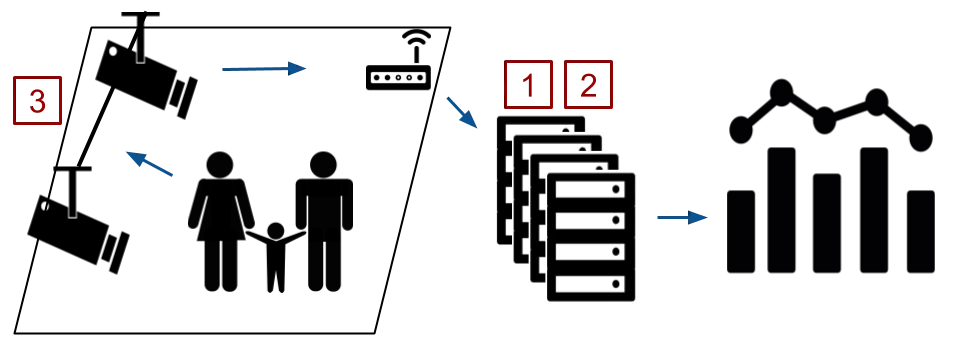
Figure 1: *System diagram of the retail analytics product. Track light cameras capture shoppers and stream store video through a base station to cloud servers. Computer vision algorithms process the video, turning raw video into occupancy, demographic, and interaction metrics. Technical objectives are numbered in red squares where they occur in the system.*

### 2. Summary of Phase I Activities and Accomplishments

The major goals of our original objectives, and the key technical outcomes are as follows:

### Technical Objective 1

- Major Goal: Automate feature generation for behavior classification*.* The space of possible behaviors is very large and it is infeasible to hand-engineer algorithms that recognize them all. Convolutional neural networks will be used to automatically discover feature vectors for numerous human actions.
- Key outcome: Instead of a fully convolutional pipeline, we designed a four step process of: detection, tracking, pose estimation, and action recognition. Detection and tracking is complete. Work on pose estimation and action recognition is ongoing.

### Technical Objective 2

- Major Goal: Recognize spatial relationships from multiple camera views*.* Further critical knowledge about the relative distances between people and objects will be inferred using overlapping viewpoints from multiple cameras.
- Key Outcome: Algorithms to create a 3D projection of a storefront, capture the locations of shoppers, and determine the relative distances of moving objects were created. Later, hardware and software alterations were made that decreased erroneous location results and could be used to determine exact distances.

### Technical Objective 3

- Major Goal: Design and deploy completely cordless camera modules*.* Simple camera installation would allow Perceive clients to place cameras anywhere, without being restricted by power outlets or Ethernet ports. A prototype showed that wireless power transmission and specialized network topologies could make a cordless installation feasible.
- Key Outcome: A completely cordless camera, powered by track lighting fixtures and wirelessly networked has been developed. Hardware has been installed in two retail locations, and laboratory testing of mesh networking software is finished.

In the course of performing Phase I research and development Perceive ***has completed Technical Objective 3 by designing and installing cordless cameras, completed Technical Objective 2 by creating multi-view algorithms to locate shoppers in stores, and achieved considerable advancement on Technical Objective 1*** such that it is expected to be completed by the end of 2017.

### 3. Detailed Description of the Work and Results

### Technical Objective 1: Automate feature generation for behavior classification.

“Behavior classification” is of critical importance as it is the technology powering the shopper analytics that retailers are interested in. “Automate feature generation” suggests the use of neural networks and training data and this is exactly the direction outlined in the Phase I proposal. We began work on this objective by applying promising Convolutional Neural Network (CNN) designs from the academic community, but needed to adjust our research plan as we learned more about the unique constraints and opportunities of our product. As shown in Figure 2 there are three approaches to this problem: (a) Two-stream CNNs where temporal and spatial data are fused somewhere in the pipeline (b) Frame-based CNNs where convolutions are done across multiple frames and (c) CNNs without classification layers that feed into a neural network which processes sequential data (e.g. text or speech). We began working with two-stream CNNs, instead of the other two approaches, because we favored the way their design explicitly captured motion information. Data fusion compensated for weaknesses in the static nature of CNNs, and experimental results on difficult datasets showed promise. Furthermore, they had momentum in the research community.

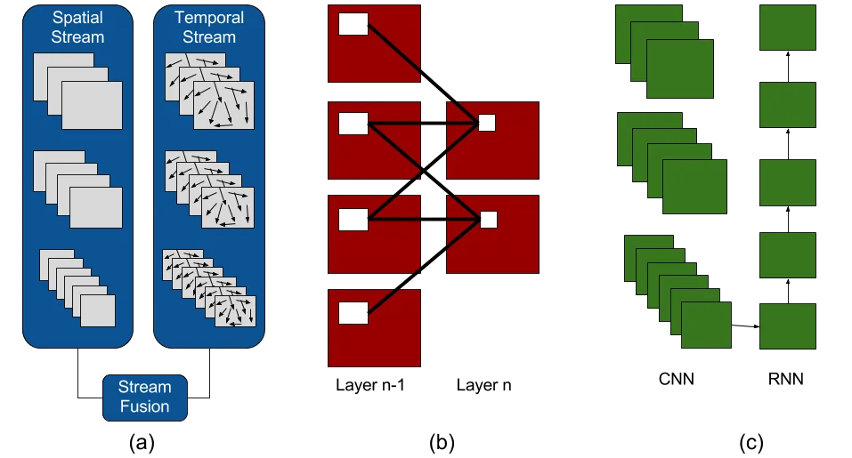
Figure 2: *There are 3 approaches to consider for doing action recognition in video. (a) The two-stream approach uses two convolutional networks, a traditional network that considers the spatial relationships between objects (e.g. two arms close to each other are likely to be a person) and a temporal network using motion vectors as input. (b) Another approach is to use a single network and do convolutions on multiple frames in a single pass. This could be considered a 3D temporal convolution. (c) A third method is to feed the features from a convolutional network into a sequential network. The objects in each frame are classified and form a sequence that can be classified into an action using a sequential network like a Recurrent Neural Network (RNN).*

In the course of our investigations, we found that two stream CNNs seemed to suffer from the same drawbacks as neural networks processing single images. We experienced poor generalization from training data to our retail datasets. Existing public video datasets were termed “difficult” because of the variety of lighting, camera angles, and video quality, a surprisingly detrimental feature because the Perceive retail dataset is somewhat uniform in lighting conditions and camera angles. Second, the convolutional architecture of the two stream networks precludes them from quantifying a specific number of people and associated actions. For example, these networks were able to identify “a group of people jumping” but could not distinguish easily between “3 people jumping” and “4 people jumping”. Even the integration of a regression counting layer similar to is inadequate to solve the problem of maintaining inter-frame associations for those counted people. Beyond architectural considerations, our attempts at building these networks were adversely affected by two implementation issues, namely the computational intensity of stream fusion (analyzing a 10 second action clip took 150 seconds on a GPU server) and no functionality for directly localizing actions within a scene. It is not enough for many important retail metrics to know what is happening in a given camera view - the locations of shoppers relative to shelves, associates, and each other is also pertinent. These important findings, discovered in the process of developing research into a commercial product, led us to reevaluate the feasibility of action recognition in raw video using only neural networks. Drawing inspiration from behavior classification method (c) above we sketched out a new plan for completing Technical Objective 1 consisting of four sequential steps: (1) Reliably detect people in individual frames (2) Link those detections into tracks to build a temporal sequence of the shopper in a scene (3) Estimate the pose of each person using keypoints such as elbows, knees, and shoulders and (4) Apply deep learning or customized computer vision on the sequences of those body parts to identify actions and behaviors in a similar manner to how a gesture recognition system would classify hand motions.

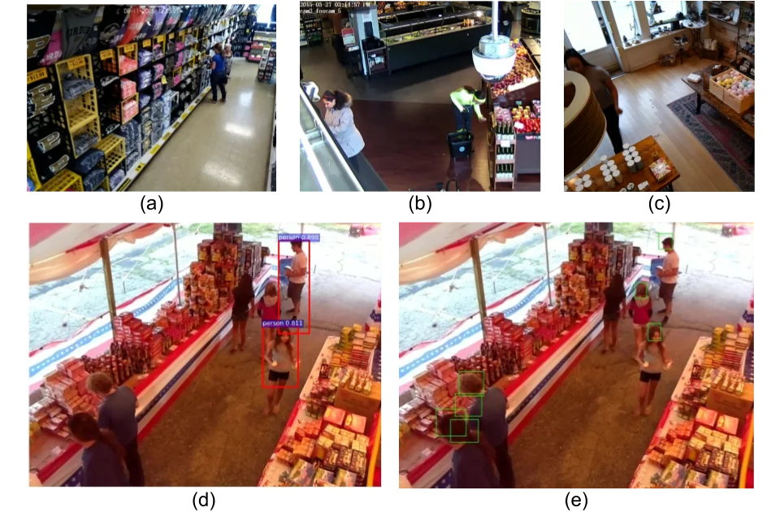
Figure 3: *Three examples in Perceive stores of people occluded by (a) other people, (b) objects in the store and (c) ceiling fixtures. (d) A person detector network identifying 2 out of 6 people in a Perceive store vs. (e) our face detector network identifying 5 out of 6 people.*

People detection and localization are well studied problems and we implemented a state-of-the-art region-based convolutional network trained on the MS COCO dataset and fine tuned on our data. Unfortunately, the cameras occupy a unique vantage point in retail stores where shoppers are often (a) very close to the lens relative to common pedestrian detection applications (b) heavily occluded by other shoppers, objects in the store or lighting fixtures in the way of the cameras as shown in the Figure 3, a - c. Furthermore, the cameras are placed at a steep enough angle to distort the shape of a person and render open source pedestrian datasets useless. Finally people detection networks are much slower to train because the variability of people (shapes, colors, and poses) necessitates a large amount of training data to achieve acceptable accuracy. To overcome these issues, we examined the indoor scenes and realized that the same viewing angle and distance characteristics that were causing such problems for people detection could be used advantageously in face or head detection. Faces are a decidedly unique object in frames and although they are typically too small and pixelated to be useful in generic pedestrian detection, our indoor viewing point meant that faces appeared fairly large. And so we tagged several thousand faces in our retail stores, trained an off-the-shelf face detection CNN, previously trained on the Brainwash Face Dataset, on that data, and achieved good results (88% evaluation accuracy). As an added bonus, the performance issues in both training and evaluation, which were endemic to the people detection network, largely disappeared because of the smaller size of faces and their homogeneity.

Satisfied with the baseline detections the face network was producing, the next problem was to link those detections together into tracks - i.e., sequences of detections for the same person. Multi-object tracking is a well defined problem and here, again, we leveraged the unique aspects of our product to produce very good results. In this case, our analysis is done offline because the analytics need only be ready by the next day. This meant, for example, that our tracking algorithm could look forwards and backwards in time to correctly associate the right detection with the right track. This understanding led us to the class of globally optimal tracking algorithms and we implemented a variation of the Viterbi dynamic programming algorithm originally used for radar tracking. This first try suffered from a combinatorial explosion in time complexity as a function of the number of detections (e.g. 6 detections per frame processed in 80 milliseconds, 7 detections in 2 seconds, 8 detections in 90 seconds, etc.). A second version built on the Viterbi techniques but utilized a graph search algorithm implemented with dynamic programming to eliminate the computational impasse on solving for the best tracks (e.g. processing each frame took a few milliseconds with any number of detections). An important side effect of globally optimal trackers is they can recover from missed and faulty detections with relative ease. Thus, to ensure that the best tracks possible are created, the confidence threshold on the face network was lowered to the point that false detections were produced and effectively handled by the tracker.

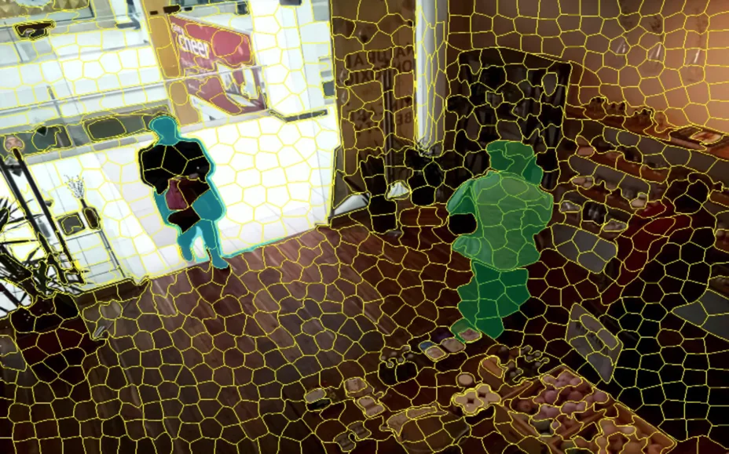
Figure 4: *An image with segmented superpixels on bodies.*

Demo: SLIC superpixels and stereo disparity on a Perceive office camera, recomputed in 2026 from the original recordings. Faces are blurred.

Pose estimation, or estimating the configuration of a person’s body within a single frame, is the last task before action recognition. A neural network pipeline to determine the pose of a person has two components: (1) it recognizes person keypoints, e.g. elbows, shoulders, and knees and (2) it intelligently links those person keypoints into a pose. For example, it must connect the left hip to the left shoulder else a deformed pose is produced. Pose estimation may also be used to eliminate a large portion of occlusion instances (cases where two or more people overlap in an image from a single viewpoint). Occlusion is a very difficult problem in computer vision that wreaks havoc on tracking algorithms when not properly addressed. The ability to identify person keypoints on individual blobs allows the tracker to better separate targets which are heavily occluded. A dataset of person keypoints is needed for a neural network to recognize them. To assemble this dataset, we start with a web tool that shows users “super-pixeled” images. Super pixel algorithms divide an image into many small regions (called super pixels) that are defined by edges and lighting changes (Figure 4). To train our keypoint detection network we combine these super pixels into segments and feed them to the network. The number of training images required for high accuracy is very large, on the order of 50,000 and the team cannot label all of these images ourselves. To quickly produce this training data at scale we enlist a task service where users are paid per image they segment and tag. These tasks are randomly populated with a small set of ground truth images labeled by us as well as a set of duplicate, untagged images where labeled results are cross validated for the purpose of checking task-doers work. Although this labeling mechanism is in place, we have not yet used the task service at a large scale to create the keypoints dataset.

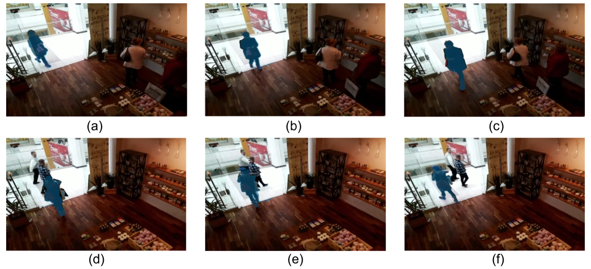
Figure 5: *(a - c) A “shopper enter” action shown in three sequential frames. (d - f) A “shopper exit” action in sequential frames. In each frame the shopper in question has been segmented from the background in blue.*

With detection and tracking complete and pose estimation underway, we began the task of building sequential networks which recognize shopper actions. For this task we are considering Long Short-Term Memory (LSTM) networks, a class of sequential neural networks commonly used in speech recognition. As of this proposal submission, work to create and train the action recognition network is ongoing, but there are a few notable aspects to report. First, store entrance and exit (Figure 4), the most basic of actions which we are currently classifying using multi-view cameras as described below, tracking, and location heuristics, are serving as a burgeoning dataset for testing our component-based action networks. These sequences, which are saved from analyses currently delivered to pilot retailers, will be run through detection and segmentation networks and the tracking algorithm to produce rough data which will be refined by hand and fed to the LSTM. As we build off our success identifying store entrances and exits, more complex actions (picking up products, browsing shelves, etc.) will be added in. It is expected that some sequential method, if LSTMs are found to be inadequate, will supplant the the location heuristics presently used.

As of this report, Perceive’s development of action recognition technologies is ongoing. It is priority to finish the full-store tracking work, development that has taken longer than expected because of problems with the initial multi-view implementation described in Technical Objective 2, namely a severe geometric edge case and store layout issues. However, a substantial amount of research and development, including the implementation of the cloud infrastructure to run the detection and tracking software, much more straightforward relative to action recognition, has been completed for Technical Objective 1. We could no longer afford to execute all software on one massive machine for cost reasons, nor was this optimal from a redundancy standpoint. Instead Perceive implemented a backend infrastructure based on principles standardized at large internet companies, including a REST API in front of the database and a distributed microservices architecture where workers consumed tasks from a job queue. This work, along with the development of a detector, tracker, labeling tool for a pose estimation dataset, research into action recognition approaches, and delivery of shopper traffic numbers in a retail store has encompassed most of the development time allocated for Technical Objective 1. Although it was necessary to pause development during the summer of 2017 to solve a critical technology problem in full-store tracking, we expect to complete the remaining work by the end of 2017 and reach a firm decision on our behavior classification approach.

### Technical Objective 2: Recognize spatial relationships from multiple camera views.

Recognizing spatial relationships from multiple camera views, is necessary for delivering spatial information (e.g. customer proximity to shelf and associate) to retailers. The first natural question to pose in this work is where the second viewing angle comes from. There are two options: (1) multiple, monocular cameras considering the same location spaced at least a meter apart or (2) a single, binocular device where there are two cameras in the same physical casing. (1) provides more flexibility and greater depth of field (the distinguishable distance in 3D space) but forces the retailer to deploy more devices in their stores than is necessary while (2) limits the sheer amount of hardware but decreases installation flexibility (because it is more important to find a “perfect” viewing angle) and reduces the available depth of field. A hardware constraint – the embedded devices had a single port to connect to the camera – made this decision for us. Of course two circuit boards could have been packaged into one device casing but a focus on a simple prototype and rapid deployment made this option undesirable to start. At first it was not clear how important this task was relative to the first and third objectives. We suspected that accurate distance information (how close shoppers were to shelves, associates, and other shoppers) would be useful to retailers but considered this to be a third priority when planning development. In reality, multi-view geometry turned out to be essential to delivering traffic metrics and solving some problems that cropped up in the first objective, among them occlusion handling, entrance and exit counting, and face clustering. This was not obvious until the hardware was in the field and video was uploading from stores. The single view tracking and detection algorithms did not perform well enough to be relied on for automated analysis until multi-view geometry was integrated.

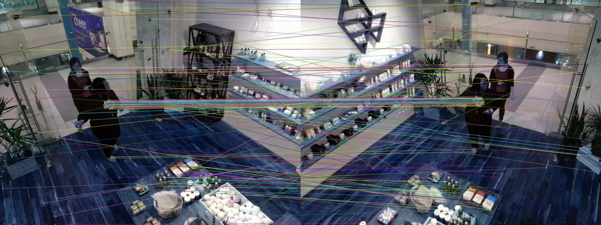
Figure 6: *A multi-view scene from a Perceive pilot store. The colored lines crisscrossing the two views link interest points which have been matched to each other as being the same point in the scene. This matching is what transforms two 2D views into one 3D projection shown in Figure 8.*

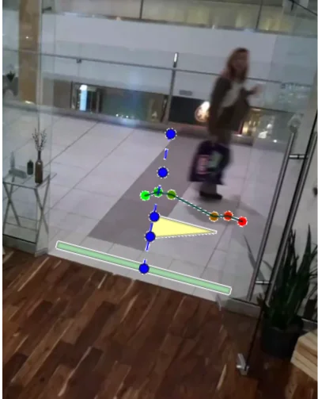
Figure 7: *The door plane (green) and perpendicular plane which establishes when people pass the store (blue) are shown overlaid on the right view (which is why the blue line in particular is skewed). This shopper’s track starts with at the green dots and ends at the red dots. Her track crosses the blue line and thus she is counted as passing the store and not entering it.*

Two different development paths were considered. One approach was to build a complete three-dimensional (3D) reconstruction of our two store’s entrances, including the locations of detections and then use the resulting 3D locations as an input to the tracker. The second method was to build a 3D model of only certain static areas of the scene, like the floor and the entrance, and work backwards from detections and tracks to register a detection in one view with a detection in the second view. The first approach was untenable because it was computationally expensive to run our 3D correspondence algorithm on every frame of every video and because the actual development time for the software was estimated to take a few months. Thus the following algorithm is based on the second method which suffered from none of the first approach’s drawbacks. First the intrinsic parameters of the camera are estimated for each camera. The intrinsic parameters model physical properties, such as focal length and pixel dimensions, and is used to transform pixel coordinates into real world coordinates. Next, multiscale features, similar to classical interest point detectors such as SIFT or SURF, are computed for each view. These interest points are matched under the constraints of two-view epipolar geometry using a random sampling parameter discovery algorithm. The correspondences, shown in Figure 6, were thresholded with a ratio test, and the results used to estimate the fundamental matrix, which characterizes the relative geometry of the two cameras. Finally, the matched points are normalized, triangulated and projected into 3D space as shown in Figure 8, a. The preceding multi-view algorithm, manually assisted, produces the floor plane, the door plane, and a few other static points in the store. These planes and points are used to plot tracks on a two-dimensional (2D), bird’s-eye view map and detect entrances and exits (Figure 8, b). Using the same geometries, we detected and counted prospective shoppers passing the store (Figure 7). In addition to solving the immediate challenge of automatically and reliably generating occupancy numbers, multi-view information reduced the negative effects of occlusion and was effective in improving tracking.

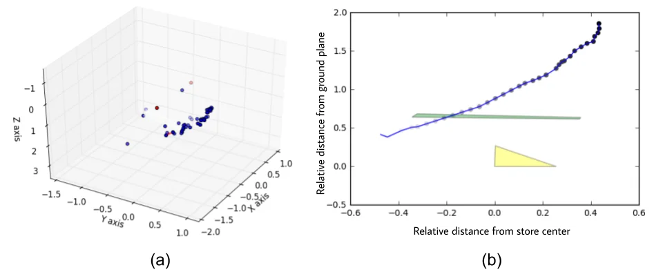
Figure 8: *(a) 3D projection of the scene in two camera views. The blue points are the 3D locations of matched interest points in each 2D image and the red points are the estimated positions of the cameras. (b) A store entrance shown in a top down view. The blue dots are detections which are connected by a track (blue line). This line passes through the door plane in green and into the store, which is an entrance. The yellow triangle is the ground plane.*

Although the single view cameras and associated algorithm served us well in our pilot stores and for our initial product, we soon discovered deficiencies with this setup which made it unworkable for full store tracking and the diversity of store layouts in larger retailers. First, large objects hanging from ceilings or very tall objects like shelves severely occluded side-angle cameras. Second, finding multi-view correspondences using interest point matching under the epipolar constraint has a critical flaw where similar interest points along the same epipolar line can be incorrectly matched. This results in customers having wrong locations in a small minority of cases. But we found this error propagates through the rest of the algorithms and degrades the end metrics in a significant way. One solution to this problem is to simply add a third camera view which changes the geometry of the scene and eliminates this edge case. However, now most points in the store must be covered with three cameras. In the ideal case where retail associates setup the store exactly as prescribed by Perceive, this is not a problem. In practice though, the ideal camera setup is rarely achieved and the area of the store with optimal camera coverage is significantly reduced. To bolster the amount of optimal coverage (points viewed by three cameras), more cameras must be installed, so many more as to invalidate the original cost saving proposition of using cheap camera devices with commodity components.

In light of these obstacles, we re-evaluated one of our two original hardware options: using stereo cameras. If side-view angles could be occluded and three physical cameras were now required for most points in the store, two physical cameras on an overhead stereo rig would obviously be better – but the rig must be able cover at least as many areas of the store as the three camera setup and “see around” obstacles. For this we can use wide-angle lenses, increasing our viewing angle by almost a factor of two, but adding significant distortion to the edge of the frame. The last piece was to ensure the availability of these parts and Perceive’s ability to manufacture one to two hundred devices with them. Fortunately, the hardware ecosystem surrounding our original platform has evolved significantly such that vendors and build processes are available now for all necessary components. In software, stereo offered a critical advantage versus the three view setup in that depth information is available natively. The interest point algorithm was no longer necessary and all operations can be done directly on pixels. This means that 3D location information is now produced faster *and* more accurately. This is only possible with excellent distortion correction (Figure 9) and stereo calibration, two cornerstone technologies that took us from the summer through to the end of the Phase I grant period to perfect.

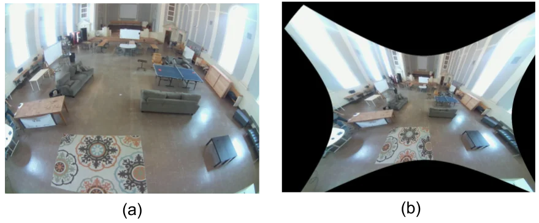
Figure 9: *(a) Wide-angle lens which produces a distorted image with a very large field of view (b) View after distortion correction is applied*

Demo: The polynomial lens model straightening a wide-angle frame, then the ArUco calibration cube, rendered in 2026 from Perceive calibration data.

The importance of Technical Objective 2 to the most basic product functions was surprising and the team shifted resources rapidly as it became clear. Progress has been steady and we have been able to successfully triangulate the locations of shoppers in retail stores as described in our Phase I proposal. At first, we employed a shortcut in our use of tracks and detections and did not directly compute a dense point cloud from each camera view. In doing so the desired result was achieved for an initial prototype which provided us with critical customer feedback. Later, it was discovered that this shortcut was insufficient for a realistic production setting and robust full-store tracking, and the algorithms in Technical Objective 2 were re-engineered. Technical Objective 2 has now been completed with the development of a multi-camera system which can discern the exact distances between objects in a scene.

### Technical Objective 3: Design and deploy completely cordless camera modules.

In addressing Technical Objective 3 we were attempting to deliver on one of the main value propositions for the company: eliminate the intense installation process of existing vision-based retail analytics systems. Work began in the direction outlined in our Phase I proposal and although we eliminated the networking cables through the mesh networking solution originally proposed, field experience and research results compelled the team to engineer a novel solution for removing the power cable. Early experimentation showed that ambient indoor energy harvesting would not be sufficient for even the minimal power needs of the camera devices (experiments showed harvestable power of 20-80 μW). A more promising approach is to beam power directly to the devices using microwaves. Wireless power transfer (WPT) exists in many forms, from the induction charging popular in many consumer electronics to passive NFC receivers used in mobile payments and inventory control. Microwave WPT is typically used for extremely long range charging scenarios such as providing electricity to aircraft from the ground but these setups operate at an unacceptably high RF power output measured in megawatts. Camera devices in retail stores must conform to FCC regulations that limit the power intensity of radio waves in open air (47 C.F.R. § 15, 1991). Thus the engineering challenge is to design transmitter and receiver circuits for microwave WPT operating within regulatory limits which provide adequate power to a camera (200 mW), wifi radio (200 mW), and embedded processor (100 mW).

Towards this end we have conducted laboratory experiments with prototype circuits with a goal of drawing 0.5 Watts from a receiver that is accepting microwaves from a transmitter located 10 meters away. Preliminary designs built using commodity components show promise, performing within an order of magnitude of their needed values. Additionally, Perceive’s operating environment provides benefits which make this engineering problem more manageable. For one, the cameras are stationary and an advanced phase array that continually tracks objects, traditionally the most difficult piece of WPT systems to design and build, is not necessary. Second, the devices are located on the ceiling which we have observed should give a clear path from the transmitter to the receiver. Finally, the distance to transfer power, on the order of tens of meters, is relatively short compared to most use cases of microwave WPT.

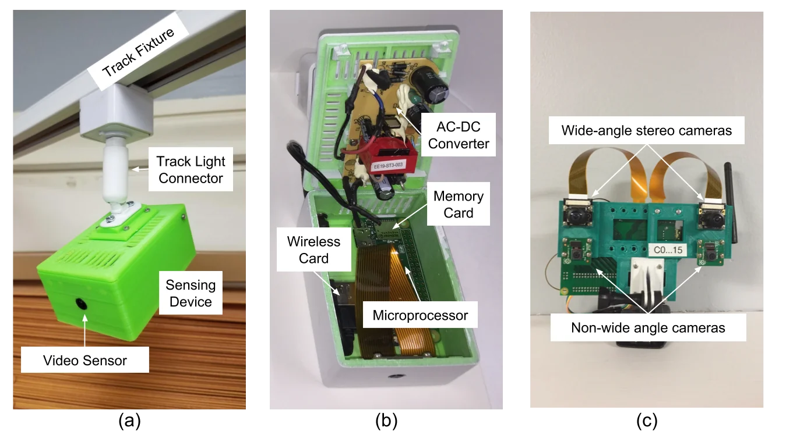
Figure 10: *(a) Exterior view of Perceive’s track light camera. (b) Labelled, interior circuitry for the camera module. The bottom case houses a camera, embedded processor, Wi-Fi dongle, and conversion circuitry for power input through the top connector. (c) Stereo camera rig*

We have found wireless power transfer to be feasible for our application but significant engineering effort in the form of circuit design and specialized component testing is needed to achieve the “last mile” progress which will close the power gap and increase the transmitting distance. Short on necessary development time and facing a looming deadline to deploy hardware for case studies before the holiday retail season, we came up with an effective workaround: cameras which snap into, and are powered by, track lighting fixtures. While walking several malls in the course of our customer discovery process, we observed that a surprisingly large number of retail operations had track lighting covering most of their stores (45/58 or 77% of stores in the local mall). These are long, skinny metal casings which have power running the length of the fixture. Retail employees can easily snap lights in and out of these casings to show off individual merchandise on the shelf as it changes. In fact, track lights are the predominant light source in many establishments. And because they are typically used for many lights, these fixtures support a maximum of 2400 Watts, more than sufficient for many camera modules which consume 2.5 Watts each. From this discovery we modified the camera casings to snap into track lights, adding the necessary AC-DC conversion and protective circuitry for the embedded device (Figure 10). This design has proved robust enough to be deployed in our highest profile pilot store, across two separate locations. Track light coverage in these stores (as in many that we surveyed) is dense enough that, when combined with two axes of rotation, we achieve nearly as much flexibility in camera coverage as we would with WPT. Furthermore, the overarching drive to reduce installation and maintenance overhead has benefited in unexpected ways from this solution. For example, the devices being attached to a lighting circuit means they can be power cycled to overcome camera or Wi-Fi radio problems by simply flipping the light off and on. Retail associates adjust track lights regularly as the store gets re-merchandised so they are as comfortable with Perceive cameras as they are with the lights.

The mechanical design and manufacturing of the camera hardware and its pronounced business utility were significant enough to warrant a provisional patent which was filed in February 2017. In summer 2017, problems with store layouts and the initial multi-view algorithm necessitated a change to the hardware to incorporate stereo cameras. A development rig, built to test both wide-angle and standard-angle lenses is shown in Figure 10, c. Current hardware development is focused on integrating these stereo cameras into the existing hardware design, a task which requires modifying the existing packaging for the device but does not affect the other components. Those components and the simple and robust design of these cameras has been successful: in ten months of operation across three different locations there have been no electrical or mechanical failures.

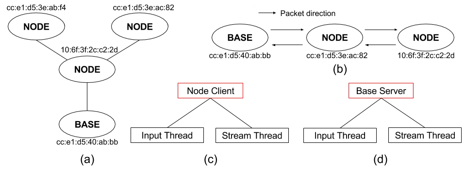
Figure 11: *(a) Two nodes camera nodes connected to the base station through a single other camera node (b) Packet transfer diagram for serial nodes (c - d) Threading architecture for receiving messages and streaming video. Nodes and bases are labeled with MAC addresses to demonstrate which networking layer is being used and that each is an individual device.*

The second on premise technology in use at Perceive, and one that plays a meaningful role in reducing installation overhead, is mesh networking. Running Ethernet cable to each camera is prohibitive at the target price point and most stores are too big to be covered by a single wireless router, especially with a strong enough signal for video streaming. Furthermore, any existing wireless coverage in retailers is either spotty or heavily interfered with by other Wi-Fi networks. In order to transmit video from the far corners of the store, the cameras must connect to a base station through each other in arbitrary fashion (Figure 11, a and b). We accomplish this with BATMAN, a layer two mesh routing protocol. Deploying BATMAN is challenging for two reasons: (1) the cameras should automatically connect to each other and the base station on startup and (2) most mesh network use cases are for small, infrequent data transfers such as Internet of Things devices while our workload consists of large, consistently streaming packets. We addressed the second challenge first by testing the max number of video streams that can pass through any one node and using that as a constraint to determine the max size of a single mesh (where single mesh is defined as 1 base + N nodes) while also transmitting video in a separate thread (Figure 11, c and d). We then ran tests to investigate how many video streams one node with a relatively low power embedded processor could handle. The tests showed that one stream had 15% packet loss, with packet loss increasing linearly up to eight streams which had 70% packet loss. These results informed which constraints must be enforced on camera layout and network topology. A solution to the first challenge of automatic connectivity was simply shifting network setup responsibilities into scripts which run at device startup. Perceive has not yet deployed the above networking software to client stores. Instead we have a reporting system that handles network connection issues across stores and alerts the team to remotely reset cameras and recover data.

The mesh network technology, while useful in solving the in-store networking problem, may never actually be deployed into stores. A preliminary freedom of operation search conducted in Spring 2017 revealed existing patents which Perceive may be in danger of violating if mesh networking is included in the camera devices. For camera deployments in the next year this is likely not a problem because a stronger antenna in the base station will provide sufficient strength for camera devices across the entire store. For larger installations, a series of intermediate base stations could be deployed which themselves use mesh routing to connect to the main base station. A system consisting of the cameras, the intermediate base stations, and the main base station would not be in danger of potentially violating existing patents.

Technical Objective 3, design and deploy a completely cordless camera, has been successfully completed. The patent pending track light cameras were easily installed in two stores and have been recording and transmitting video over Wi-Fi and through a base station to cloud servers for several months. Development of video streaming and communication software over a mesh network is complete, has undergone successful testing but deployment is delayed indefinitely to mitigate patent infringement concerns. This hardware design has performed so well for Perceive, reducing the dollar cost, time investment, and maintenance overhead, while improving flexibility, that it is expected to be the basis of all major hardware designs for the foreseeable future.

### 4. Other Outcomes

**Training and Professional Development**. The principal team members of Perceive are all recent graduates and although the team has depended heavily on the advice and direction of experienced business leaders and scientists, the vast majority of work has been planned and executed by the core team. This experience, including research into “hot” fields like computer vision, machine learning, and low power embedded devices, scoping and building a technologically advanced product, executing a customer discovery and market validation plan, deploying a video analytics system to active retail locations, and establishing a relationship with and garnering revenue from an initial customer, has been quintessential to the personal growth and career development of the entire Perceive team. Our technological skills, business acumen, and managerial instincts have been profoundly, positively impacted by the opportunity to commercialize our research through this NSF SBIR Phase I grant.

**Dissemination of the Results to Communities of Interest.** We gave a TedX talk in Fall 2016 to 450 students, faculty, and staff from Purdue University. The talk discussed why the technology underpinning Perceive was ready for integration into real products and possible applications beyond retail. The talk was well received and is currently available on YouTube. Perceive also plans to publish pieces of its research including datasets but has not done so yet.

### 5. Impacts

**Impact of the Development of the Principal Disciplines.** Recognizing human behavior in physical environments is useful in areas far beyond retail. Systems to lifeguard pools, assist teachers in managing classrooms, prevent the spread of disease in hospitals, and analyze congestion in city streets are all possible with the technology discussed here. Research in the computer vision community on action recognition from video has seen renewed excitement because of the success of new deep learning techniques but there has not yet emerged a pipeline which combines these schemes in way that is accurate, general, and efficient. On the other hand, multi-view geometry and tracking methods have seen steady advances in the last two decades thanks to increased processing power and better algorithms but knowledge and understanding of these systems remains limited to specialists. The widespread deployment of Perceive’s technology for the aforementioned applications will catalyze research breakthroughs, informing scientists of which problems are noteworthy and what ideas work well in practice, notwithstanding our own contributions to the field in the form of papers, code, and datasets.

**Impact on Other Disciplines.** The principal field that stands to benefit from the work conducted here is psychology. Datasets on human behavior have typically been small and required arduous manual labor to construct. Action recognition software utilized for clinical studies and behavioral profiling could help researchers studying people improve the statistical significance of their results and reduce the lag time from hypotheses to conclusion. Michaux’s thesis work in computational psychology delves into human perception of shape as a key prior to contextualizing objects and associating them in memory. At Perceive this question of shape in the mind is a deep concept that informs algorithm design and eventually psychological inquiry.

**Impact on the Development of Human Resources.** As discussed in Other Outcomes, we have benefited tremendously from exposure to research, productization, and commercialization through this grant. Further, the company has hired two interns, both undergraduates in engineering and science, for various essential tasks. These students are working on technology and thinking about problems drastically more challenging and engaging than those encountered in their studies or even in entry-level industry jobs. They are experiencing a company at its earliest stages and working on projects which directly contribute to the success of the nascent organization. Beyond the direct employees at Perceive, we are working to spike interest in computer vision technology throughout the community by giving talks and fielding questions at clubs, roundtables, and classrooms.

**Impact on Society beyond Science and Technology.** The work performed through this grant, distilled to its barest form, is about people; understanding them, helping them, and improving their lives. Computers have transformed people’s digital lives but the way we interact with the physical spaces we inhabit and how we relate to each other face to face remains somewhat rudimentary. Action recognition, behavior analysis, 3D scene reconstruction, and cheap, easily installable devices to enable it all are the foundation for a new suite of technologies which will make people and the brick-and-mortar places they go, from the classroom, to the city, to the retail store, more effective, efficient, and sophisticated.

### 6. Remaining Issues for Commercialization

Research and customer discovery conducted over the preceding seven months has shown three technology verticals that require further engineering investment during Phase II: (1) face recognition, (2) store camera layout, and (3) analytics programs. Improved face recognition and identification, which will be the primary technology focus of a Phase II proposal, will improve the baseline detections utilized by the tracking software and the quality of our metrics by eliminating employees and children from consideration for certain benchmarks. Better face software will further enable features that fulfill our *demographics* value proposition such as unique vs. repeat visitors for physical stores, demographic information, and sentiment analysis through emotion. Two secondary areas of the Phase II work are (i) computing optimal camera layouts to minimize the number of units but maximize the visible area covered which will enable *interactions* and improve *installation* and (ii) analytics programs which correlate transaction data, inventory catalogs, employee schedules, and other store data with Perceive video information. We’ve found that even computing basic procedures such as regressions and time series analysis on retail data requires careful thought and design in order to produce conclusions which are meaningful for retailers. These retailers can be demanding, and will not tolerate abnormal amounts of hardware problems or lost data so further camera module iteration is needed in the remaining months of the Phase I grant. Lastly, we must complete the remaining work on shopper action recognition.

### 7. Phase I Conclusions

After executing on the Phase I technology plan for eight months, Perceive has validated, discarded, or engineered around, every research claim in the original proposal and has done so while delivering its intended product to a paying customer. ***We have completed Technical Objective 3 by designing and installing cordless cameras, completed Technical Objective 2 by creating multi-view algorithms to locate shoppers in stores, and achieved considerable advancement on Technical Objective 1*** such that it is expected to be completed by the end of 2017. The team has discovered additional important areas, namely face recognition technology, camera placement in stores, and analytics tools, which warrant further investment through a Phase II grant.

## August 2018

As of this reporting we are close to being able to track persons through multiple cameras but the task is not complete. We have finished generating facial keypoints and finished developing the binocular cameras. Minor design changes and one large manufacturing process change are needed for the cameras. Work on the camera coverage model was moved forward because positioning the cameras turned out to be a prerequisite for tracking. Perceive also jump started our efforts on tuning and testing the camera software and cloud system for all-new hardware, retail stores, and product requirements. The analysis infrastructure has been completed and is used daily by the labeling staff. Lastly, the statistical analysis of customer service events is underway, but towards a goal of filtering down the amount of data which a human labeling associate is required to review. Development on biometric features related to identifying an individual has been suspended because product changes rendered the technology unnecessary.

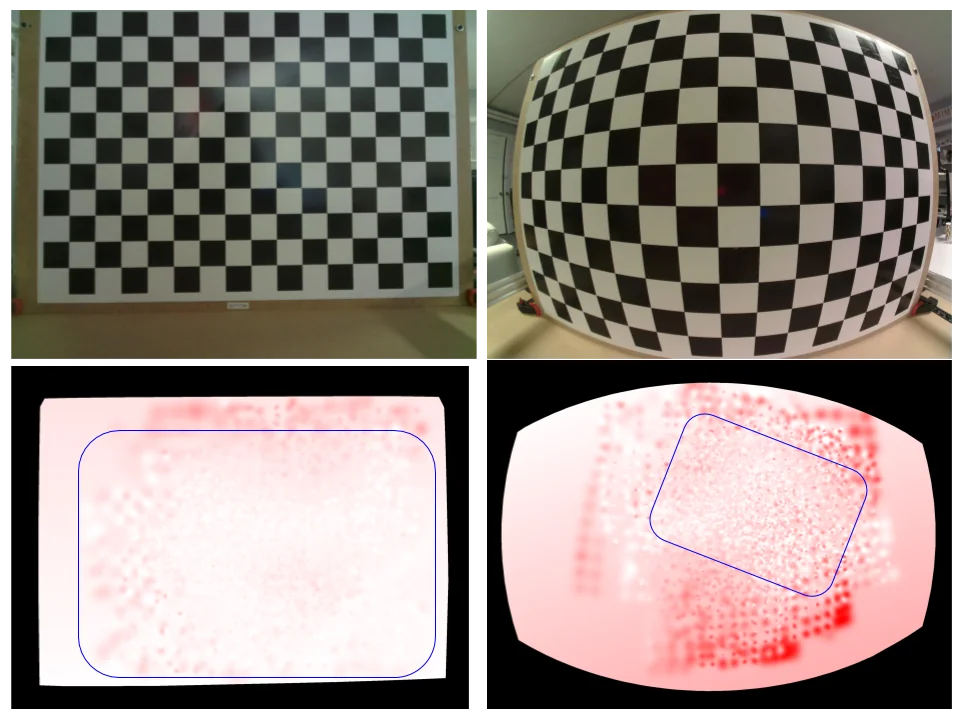
Figure 3: *Visual comparison of the rectilinear lens (top left) and the wide angle lens (top right). The bottom images are a visual comparison of stereo calibration error, with white representing low error and red representing higher error. The goal is to have a large area of low error which is critical for producing high quality point clouds. The rectilinear lens (bottom left) exhibits this but the wide angle lens (bottom right) does not. The blue rectangle is an area of consistent error.*

Building a system to track persons throughout a 3D space has meant getting each component of a multi-level hardware and software system correct and we have made tremendous progress towards this. However, halfway through Perceive’s Phase II grant this task is still ongoing. The challenge in this reporting period involved both positioning the cameras correctly once they were installed and consistently generating a good point cloud from all cameras. Previously we have generated a good point cloud from two devices, with a dense array of points and reasonable object distances *relative to the camera*. The next step, positioning the cameras, proved challenging and we realized that our planned work on the camera coverage model, Task 7, would be useful in solving some of the technical issues. In hardware we found that our distortion calibration process, although it returned a low average error and a good point cloud, actually affected different parts of the lenses differently (Figure 3, bottom). This is problematic because it means that objects used to position the cameras would have different dimensions depending on where they appeared in the image, leading to an unreliable procedure which failed at first in the stores. Also this caused inconsistencies in the point clouds amongst the cameras. Eventually the problem was traced back to the actual characteristics of the lenses and the wide angle lenses were dropped in favor of rectilinear lenses (Figure 3, top). Although these lenses have smaller viewing areas, their properties are better. Our previously unreliable positioning procedure now works every time and the point clouds are consistently good across cameras.

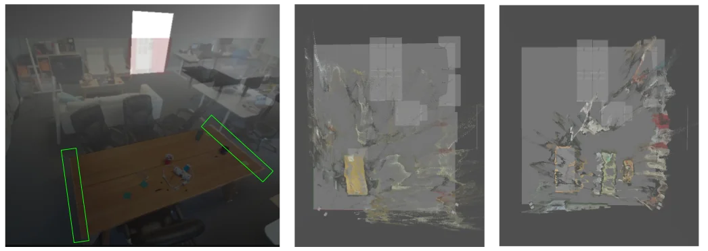
Figure 4: *(left) Pixels mapped onto the gray 3D model according to their depth. The green boxes show a good result where the pixels for the table are mapped directly onto their 3D model. (middle) A noisy and distorted point cloud. Note how the wooden table is warped. (right) A clean and geometrically rigid point cloud. The table lacks some surface points but is straight.*

Changes were also necessary to the positioning algorithm. We started with a very general purpose procedure where an object of known dimensions would be shown to the camera for several frames but ultimately found that simply manual picking a few points per camera resulted in much better positioning. Aiding our work was a manually generated 3D model we could overlay points onto (Figure 4, left). This model is useful for visualizing the depth calculated from the cameras as well as the point cloud generated from two cameras. The output of the raw point cloud was still somewhat noisy and distorted (Figure 4, middle) after the positioning work. The final step was to use all this new software with the rectilinear lenses to get a great result (Figure 4, right).

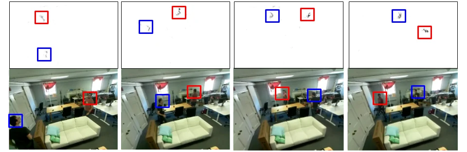
Figure 5: *Projection of points onto the floor and the corresponding video frames. Note that the projection has been rotated. This shows an excellent separation of the two people walking around from points which are not moving and this should give us great tracking results.*

The results of these efforts was our first glimpse at a truly good point cloud where people walking around are triangulated to their real 3D locations from multiple cameras (see Figure 5). This represents an important milestone in our effort to achieve full-store tracking and begets a transition from fundamental sensor and 3D data development to more high level work on tracking algorithms. Fortuitously this team already has experience with tracking from our first year of work and with data that looks as good as that from Figure 5 we anticipate that we are nearing the end of this key task for Technical Objective 1.

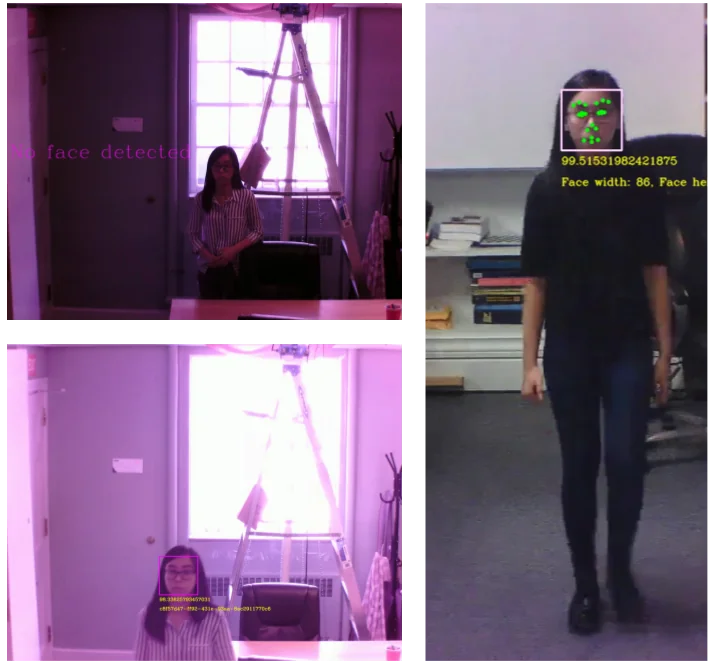
Figure 6: *(left, top and bottom) Experiments at different exposures. These were necessary to conduct because the best time to capture faces in a retail store is at the entrance. However, entrances are often backlit by skylights or displays in malls. Note that the face detection fails in the top image when the exposure is not correctly set and succeeds in the bottom image when we overexpose. (right) Excellent keypoints result after all the tests we ran. We were usually able generate twice as many keypoints as previously.*

We have completed Task 2, facial keypoints. After making great development progress during the first reporting period we spent some time refining the keypoints. Recall that we are using a third party service to generate keypoints and our goal is to feed it the largest, sharpest images of faces we can by tuning our hardware and software. To this end we conducted a series of tests on exposure, resolution, color, face sizes, angle, and video encoding (Figure 6). In particular we were able to greatly increase the quality of video but keep the video file size reasonable by recording in grayscale after determining that the facial keypoints neural network was not sensitive to color - only contrast. We were able to extract large numbers of keypoints from the data of our zoom cameras and see the identification accuracy of our system increase. This enabled us to make a change which reduced setup burden on the retailer by switching to a process we are dubbing “passive registration”. Previously it was necessary to take close up videos from several angles of the associates in the store to identify them meaning the associates would need to use a phone or some other device. With our improvements in face camera quality we can now select several good faces directly from the feed and register the associates making the process more convenient for the store and staff. We did several large scale tests, including by installing a camera in a crowded co-working space to verify that our changes had the desired effect. Finally, with regards to Task 2, we completed the key step to locating the faces from our cameras in the 3D point cloud, namely calibrating the face cameras and calculating the essential matrix between the face and stereo cameras.

A product change caused us to reconsider our approach to Tasks 3-5 for Technical Objective 1, each of which involves using biometric features in conjunction with the face keypoints to quickly and accurately identify every individual in the store. Previously we were calculating metrics like returning customers and conversion per associate that required us to know who every individual was in the store. Therefore we have suspended development on the rest of Technical Objective 1 and will submit revised tasks for this objective shortly.

Due to the tremendous development velocity of the team and product, including all new hardware, two new media sources (face and audio), new retail stores, new data flows, and greater scale across all these systems, we allocated some resources from the end of the Phase II grant to this reporting period to support our efforts. Specifically, we moved up a portion of work for Task 9: tuning and testing. Beginning a month prior to the new pilot beginning and continuing on after the pilot started we encountered several reliability issues with the camera devices and our analysis infrastructure. To address these we built more robust monitoring so we could first uncover problems and then tackled each one. In brief these software solutions included processes to deploy settings and code changes more easily, catch errors across our distributed systems and centralize them in one place, and a performance and flexibility upgrade to the REST api which enabled the team to more quickly build out applications.

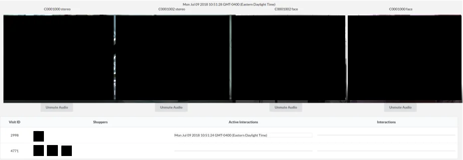
Figure 8: *Dashboard the labeling associate sees when looking for bad customer service. This represents the UI portion of Task 11 and relies on data from the analysis infrastructure. Videos and images containing confidential information have been redacted.*

Task 11: Analysis infrastructure has been completed. Like our cameras we have finished the development and are now only making small improvements and doing maintenance on the codebase. This task has continued to be relevant despite changes in overall strategy. In our initial proposal the purpose of this task was to develop a flexible data platform which a professional analyst, someone with a statistics and programming background, could use to find trends and anomalies that the retailer could work on. Since then we have pivoted from that product to a much more focused customer service product which we initially designed to be brought to market without humans. Since that major pivot though we have vectored more specifically into bad customer service and using a much less skilled analyst (their Perceive job title is labeling associate) to flag specific instances of bad service. The tool that these associates use (Figure 8) indeed brings together our video and audio data, as well as purchase information from the store, in a UI which allows them to efficiently troll through a week’s worth of action in retail stores. To help finish the UI for this tool in time for our pilot to begin we moved the programmer previously slotted to work on Task 3: Biometric features to this task. The programmer already working on it continued on the backend (camera software, REST api, and cloud system which received and organized all of the data each day).

As discussed in the Product section of this report, our goal is to greatly reduce the amount of time it takes to label a week’s worth of data from a retail store - to *filter* down the amount of raw video and audio data. We are using computer vision to do a lot of filtering but there is also other store data which can help. For example, we know that bad customer service tends to occur when the store is busier so we can bias the visits that labeling associates look at to times when there are more people in the store. There are other indicators that bad service occurred such as purchases and length of visit. Taken together we can begin to model the likelihood of a bad service event using this data and be more efficient with our labeling time. This is the gist of Task 12: Statistical Methods and work began in earnest of this task during this reporting period.

## December 2018

Perceive engineers engaged with every technical task this reporting period as we completed major projects and shifted our technical roadmap in response to customer feedback. It is prudent to separate the work into three categories: computer vision; hardware; software and data. In computer vision, multi-view track correlation and the camera coverage model, Tasks 1 and 7, were completed. In hardware, we transitioned from our current camera design to a new design, incorporating mechanical fixes as we went. Finally, our retail software integrations expanded with the use of survey data and our models of store experiences improved. It was an extremely productive reporting period for Perceive and our development matches our gradual transition from a technology development team to a commercialization team.

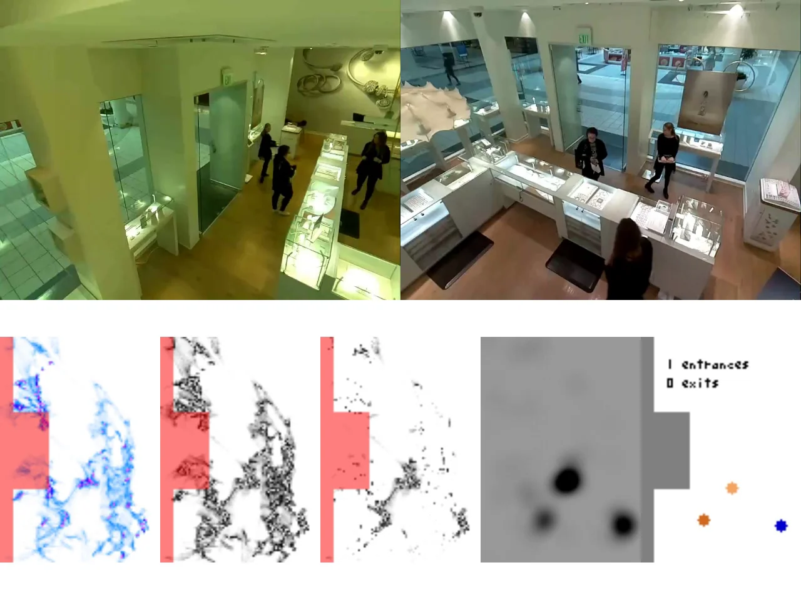
Figure 2: *Tracking results. On top are two synchronized raw feeds from the store. On bottom, from left to right, is the computer vision pipeline. Raw pixels from a merged point cloud are projected onto the floor and filtered using depth equalization and probability maps. The result is standalone people in the far bottom right. A globally optimal graph based tracking algorithm is used to follow each person around as they move about the store.*

In the previous reporting period we successfully developed a multi-camera 3D understanding of a physical area. This period we finished off this task by applying an advanced tracking algorithm to this data structure (Figure 2). The algorithm needed to be very robust against id-switch, a term of art in tracking technology where two targets are swapped. Retail stores, especially our test store, become extremely crowded through the holidays and id-switches are much more likely to occur. Thus we selected an offline tracking algorithm that employed a network flow graph optimization mechanism to adjust its previous understanding of where tracks were. A precise understanding of the locations of all people in the store was also useful in enforcing the invariant that two tracks cannot occupy the same physical space at once. This period was a good opportunity to see our algorithm perform with very dense numbers of people. Our results were very good. The algorithm was benchmarked against a series of discrete events, most prominently entrances. The number of shoppers entering and exiting the store were manually counted using a web application over a number of weeks. The tracker should know exactly where everyone and everything is and thus should be precisely able to count a shopper as they transition from outside to inside the store. In cases where the counts did not match, this warranted further examination of the parameters and adjustments to the algorithm or point cloud. A test harness was developed to hasten this process. Our long experience processing large amounts of video was helpful as a job runner was created that could process weeks of video data in just a few hours. All of this work culminated in a tracking algorithm that is robust across a variety of shopper densities and situations. This algorithm is currently running in our stores and we are tracking everyone in our test store, a major milestone for Perceive.

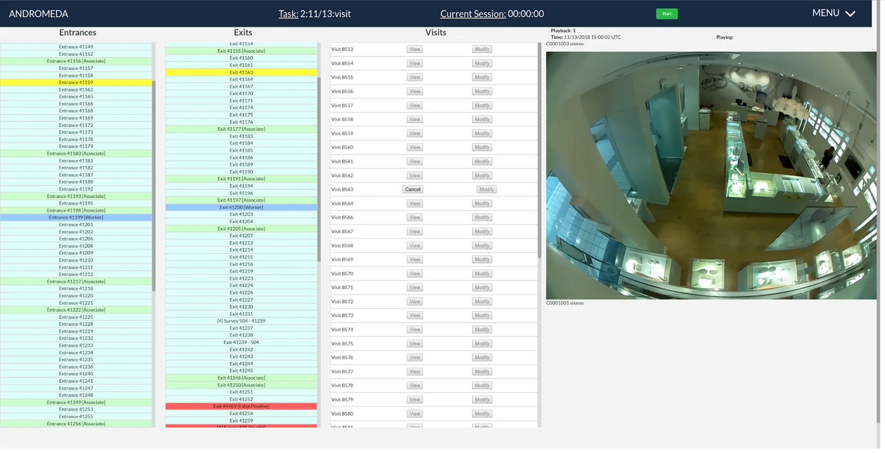
Figure 3: *Visit dataset creation tool. Visits are defined as the match of a group of customers entering and exiting the store. These matches make up the dataset for Tasks 3 and 4. This data is the key training data for the short-term re-identification algorithm.*

With tracking complete our focus turned to the last computer vision task within the scope of this grant: re-identification. In our previous report we stated that we would revise the remaining portion of Technical Objective 1. Our product requirements changed so that identifying returning customers and their demographics was no longer important. The landscape has shifted as well so that customers are more wary of facial recognition technologies. Two cashierless checkout experiences, Amazon Go and Standard Cognition, advertise themselves as protecting users’ privacy by not using faces. Given these pressures we were happy to change these tasks to focus on short-term re identification. This feature is used to bookend a customer visit. If a heavyset man in a red shirt enters the store and a heavyset man in a red shirt leaves twenty minutes later we want to use the information we have about that entrance and exit to match them. Research on this task began at the end of this reporting period and a plan has been assembled. As with other machine learning problems the first step was to create a dataset. This was a complex task as there are many variables that affect when a group of shoppers enters and exits. For example, the group may enter over a span of five minutes and leave together. We devoted some time to getting the user experience of the tool correct so that labeling was fast and accurate (Figure 3). Further, it was key to identify the aspects of this problem which make it easier than the canonical “Person Re-Identification” problem. The first is that point clouds with accurate distances between points are available. This is an interesting advantage for Perceive, not seen in the literature. This means that a large man and a small woman will appear different to our software. Secondly our search space is limited by the maximum amount of time people spend in the store, typically an hour. Our approach will use these advantages, the dataset we have begun creating, and a machine learning approach to accomplish this task and finish this objective.

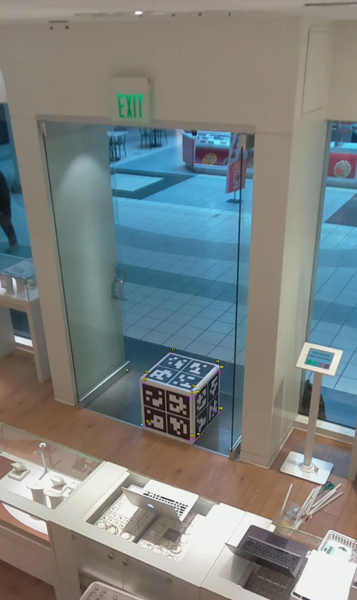
Figure 4: *Positioning the cameras in the store using a marked box of known dimensions. Each side on the box is known and the cameras use its geometry to find their absolute locations.*

Although we previously had a point picking procedure which worked to position the cameras, we realized it was specific to the office space we were developing the camera software in and may not translate to the real world. Additionally it was slow and would sometim to be made. This box was successfully used during our store install this period to position our cameras (Figure 4).

The scope of store data collection expanded this period, beyond transaction data that we have previously worked to integrate with our video. There were two new sources of data. One was a survey kiosk installed in a test store. Customers filled this out as they left. The results were timestamped and shuttled into our video analysis tools. The second data source was direct comments on the service from store management and associates. Comments are collected through our client facing web applications and stored as sensitive data. Many posts contained specific direction or observations from upper management to store-level managers. Ultimately some comments will be visible to associates and their suggestions will trickle up the chain. Supporting the organization correctly required a permissions system and users to register with the correct roles. For a brief time we also stored audio from the store, before ultimately abandoning that data stream due to technical and legal difficulties. Finally, the latest iteration of our product includes text message notifications to store employees and a purely mobile website to interact with video clips. Implementing phone number registration and notifications was straightforward. Even so it became apparent that Perceive’s databases began to represent the nucleus of store activity. Security improvements were needed, an investment that would upgrade our software to the satisfaction of future clients. It is also clear that technology startups often struggle with proper security. A company that is ingesting as much data as Perceive on behalf of clients cannot afford the reputation hit of a security breach. To protect the store data we are integrating, the systems processing it, and to make good on “A Note on Privacy” in our initial proposal we invested in some security work. Specifically we implemented a corporate VPN, strengthened our server side encryption, protected secret keys and passwords in a keystore, and audited our IT security practices. As a result of this work the engineering team is now working with a security roadmap which calls for regular checks of existing systems and additional hardening. The data integration and security work completed for this period is another example of Perceive transitioning from a firm with great research and technology to a product firm that meets the requirements for landing large contracts with retailers.

Figure 7: *Tabulation of customer service characteristic stats. This study was used to determine the frequency of occurences of various events (or codes). It also showed us who reliable different human coders were in evaluating the same event. Finally the study helped us estimate the true amount of work required to find notable events.*

The final portion of our sprawling engineering efforts this period was devoted to studying different methods of surfacing notable customer service events. We invested in studying the ability of our human labelers, hereafter referred to as coders, to consistently rate customer service events according to a codesheet. The codesheet is a table of negative and positive customer service events, assembled from a coaching form from the store and Perceive’s internal data on good service. Each service instance is given a code and then three humans are used to mark the events (Figure 7). The purpose is to measure the inter-coder reliability score, a statistical measure that indicates how reliable labeling a certain code will be. With this standard procedure in place we can conduct a variety experiments. Coders looked at videos with audio, silent videos, and the stores at varying levels of activity. Our results showed that some of the most valuable service metrics, like “associate is friendly”, are also among the most difficult to measure. They also require high quality audio. Another result was the significant time it took to label each visit. Every code could be present and most could occur at any point during visits that lasted up to thirty minutes. Studying these outcomes gave us pause - could we reliably and cheaply measure the level of customer service for the store this way? As discussed in Status of Commercialization Activities, we began to seek other data sources that could be used to surface the same events that the coders were so laboriously finding. At this juncture, we believe the survey kiosk, purchase data, and video metrics themselves will be sufficient to find notable customer service events. It is possible that a future version of the product will include a human labeler to screen movie clips which are sent directly to the store for quality and accuracy.

Perceive engaged with every engineering task during this reporting period and completed two of the major computer vision tasks. This level of activity is a natural consequence of the project moving farther from the research and closer to the product and commercial needs of our customers. This period was also the beginning of work on three tasks which saw slight adjustments since our Phase II proposal two years ago. Across computer vision, which saw Tasks 1 and 7 completed; hardware, where a new camera design was created; and software and data, where major statistical and security work was done, Perceive is on track to complete the work for this grant a few months ahead of time. This despite making adjustments to our technical tasks based on feedback from customers and market changes.

## July 2019

Perceive’s tracking algorithms are built on a 3D reconstruction of the environment that is accurate within centimeters. Existing cameras will not include depth information and the reconstruction will be approximate with a scale factor. In addition, the person detection module assumes the size of a person. The scale factor will cause this module to fail and person detection will be solely reliant on pose estimation. Existing classes of tracking algorithms, Category Free Tracking and Association Based Tracking, can compensate for this loss of information. A computer vision research engineer will spend six months implementing and tweaking these algorithms (T2).

Existing cameras pose a second challenge. There are some instances where a person will leave the view of all cameras. This happens to a degree in the current setup but is mitigated by Perceive’s full control over camera positioning. Reidentification models are used to recognize the same person within a set time frame, e.g. an hour. Perceive is already pursuing re-identification as part of SBIR Phase II Technical Objective 1 (Short-term anonymous re-identification of shoppers). The lack of accurate 3D reconstruction for the non-stereo case means there are differences between the methods proposed in the SBIR grant and the methods needed here. However, many of the ideas carry over and the two tasks are highly complementary. Michaux will spend three months conducting this research (T3).

## March 2020

In this reporting period, buoyed by the support of a supplemental TECP grant, Perceive completed every remaining task and finished each of the three revised technical objectives for this Phase II SBIR grant. For *Technical Objective 1: Short-term anonymous re-identification of shoppers*, Task 3: Appearance Dataset and Task 4: Appearance Model were completed as part of a tracker which can track 50 persons at once for 30 minutes or more. For *Technical Objective 2: Optimal camera positioning to maximize view area and minimize camera quantity*, Task 8: Scalable Hardware Design, was finished such that Perceive can produce 20 cameras a day at maximum capacity. Task 9: Tuning and Testing was also completed such that Perceive can setup a 9,000 sq ft area with 15 sensors in under an hour. For *Technical Objective 3: Web-based tools integrating different data sources for statistical analysis*, Task 10: Store Data Integration and Task 12: Statistical Models were finished as part of a user-facing web application which surfaces video moments of interesting customer interactions alongside data in dashboards that drive collaborative decision making. Overall Perceive has successfully completed the work for this NSF SBIR grant over the course of several years and brought to market a unique 3D tracking solution and collaborative product design tool in use by Fortune 500 brands and major cultural institutions.

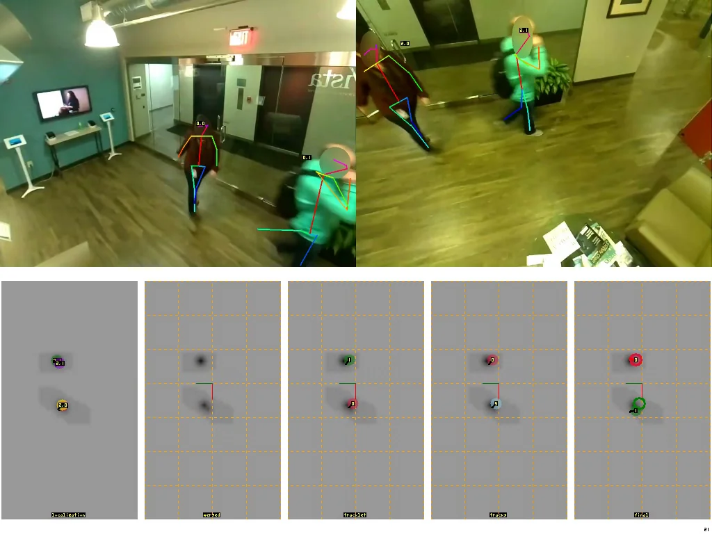
Figure 1: *(top) Two images from cameras at different angles which capture visitors entering the lobby of Perceive’s TECP commercial partner. Each person has a pose skeleton superimposed on them. These pose estimations were integrated with Perceive’s 3D data as part of the Appearance Model work. Each visitor’s face is also blurred thanks to anonymizing technology. (bottom) The 2D projection of the 3D point clouds of each person progressing through various stages of filtering from left to right. In each step the algorithm refines its idea of the location of the target using machine learning models and tracking information.*

Building an appearance model for a target is important for tracking that target for longer periods of time. Before this work the system could track a person for 30 seconds on average. Today Perceive’s tracking technology can anonymously follow a target for an average of 18 minutes. This improvement was driven by the introduction of pose estimation, shown in Figure 1, top. Pose estimation uses deep learning to find body keypoints, such as elbows and knees, to create a skeletal representation of a person. Typically a dataset, originally called the Appearance Dataset, would be a prerequisite for pose estimation. Instead, an existing model was found to be sufficiently accurate and dataset creation was delayed. Integrating pose estimation with combined 3D point clouds in a multi-stage pipeline, Figure 1, bottom, yielded a 100% improvement in per-frame person recognition. Other tracking improvements including merging aliased tracks based on the angular position of the tracklet, height smoothing, and adding dead zones. In sum, Michaux has developed a labeling program to create the Appearance Dataset and completed the Appearance Model.

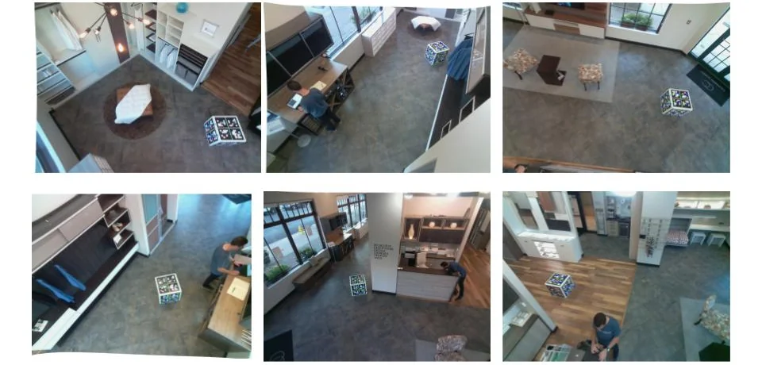
Figure 2: *Camera views from a showroom showing the calibration box moving around the store from the upper left as a person enters, down through a U shaped series of hallways, and to the upper right. The images are in reading order.*

Building a fast 3D map of a location in software is an important technical leap and moat for the company. Figure 2 shows a calibration box being moved throughout the client’s store from multiple camera views. As part of the TECP tasks T1: Build and Install 10 Prototype Cameras and T3: Identify People from One Camera View to the Next, Perceive perfected this fast setup system using the box that the cameras are packaged in for shipping. This process enabled one client to setup their 9,000 sq. ft. space with 15 cameras in under two hours.

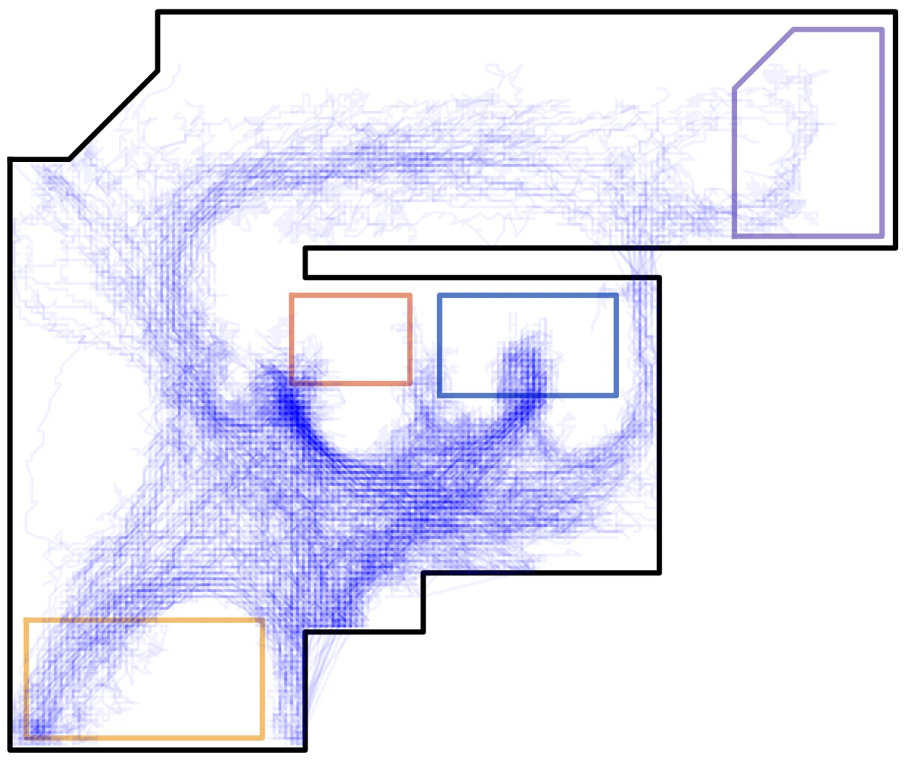
Figure 3: *The layout of the store generated with computer vision showing product regions where analysis is happening. The blue lines are tracks from customers over a week of data, with employees filtered out using statistical methods. This diagram is referred to as a heat map in the perceive web application. It shows two areas of highly concentrated activity and the traffic flows that typically occur within the store. Customers use these heat maps for wayfinding, layout, and tour orchestration.*

Significant improvements in tracking allowed the applications team to publish heat maps of extraordinary detail concerning the movements of customers and hot spots within the store (Figure 3). Note that Figure 2 and Figure 3 shows the setup and then output heat map of the same location. In the video analytics industry heat maps are standard and several customer conversations turned on the fact that Perceive’s heat maps had real 3D units and complete tracks of customers.

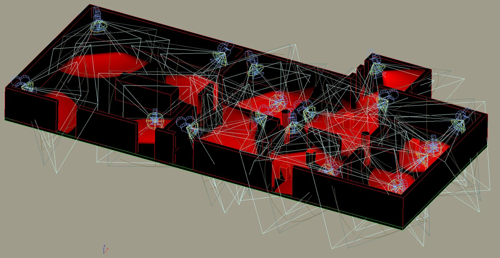
Figure 5: *3D model of 15 camera setup covering 9,000 sq. ft that is live at a client.*

With more performant 3D models, higher accuracy tracking, and increased capacity to make cameras, Perceive could take on more ambitious installs. Figure 5 shows a 15 camera install in an Indianapolis art gallery. These installs enabled the team to stress-test the software to completion. Cloud performance issues were uncovered. At higher camera volumes there were also camera failure modes. Faster installation software was needed and several procedural changes were made to allow install teams, and eventually customers, to get calibration results from the space within a minute of submitting them. A Wi-Fi connectivity issue and some UX issues around obtaining network credentials ahead of time were also worked on. These finishing steps are key to productizing a 3D capture system which is the fastest to install on the market.

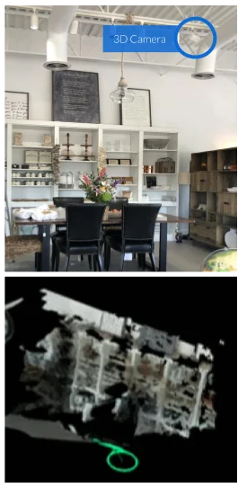
Figure 6: *(top) 4 shelf sections in a test retail store with a Perceive camera above them. (bottom) Gaze tracking where the person is tracked with a circle that has a green arrow for the direction they are facing and a solid bar indicating which shelf they are looking at.*

A serendipitous research result that up being very useful for the behavior tracking objectives of the company was gaze tracking (Figure 6). In this a “gaze cone” projects out from the user’s head and lands on a specific target within the showroom. It can be thought of like attention tracking for the real world. Perceive has integrated this feature into its other systems to produce concentrated video clips.

### CAP

A patent entitled “Three-Dimensional Camera, Visitor Tracking, and Analytics System” was filed in early March 2020 that encompassed the technologies developed under this grant for the fast 3D mapping and setup of physical spaces. The drafting work of this patent and another patent in progress will be covered by a supplemental CAP grant, submitted in February 2020. This patent is a product of the work done in this grant.

### TECP

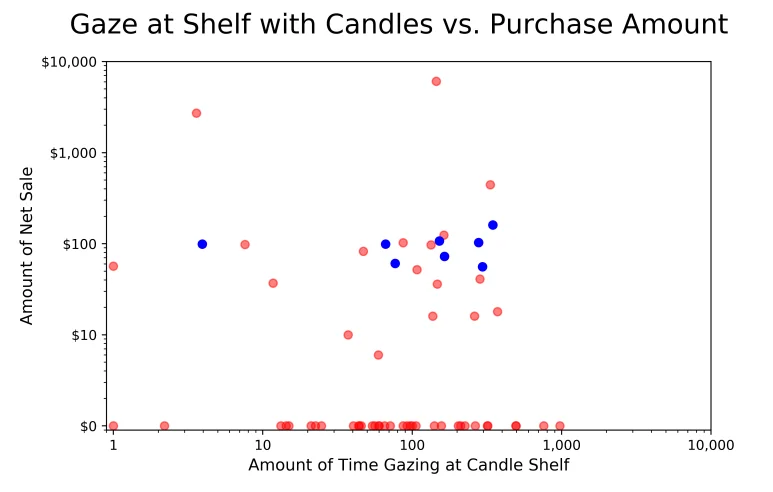
Figure 11: *A result from a test store with Perceive’s TECP commercialization partner. Attention on a set of candles, tracked via gaze, is compared with integrated purchase data.*

Perceive changed TECP partners from the original proposal but nonetheless made progress on the original technical objectives. Reidentification remains a challenging unfulfilled research objective but existing tracking technology within the company was adopted. Gaze tracking and customer data integration (see Figure 11) were notable technical outcomes of this work.

Perceive completed every technical objective of its Phase II SBIR grant, although some tasks were revised along the way in accordance with shifts in customer discovery or technical roadblocks. This work produced a patent, tracking results that convinced a Fortune 500 brand, a major cultural institution, and a top Ivy League school to buy Perceive’s software, and attracted a team that was strong enough to be accepted into a Silicon Valley accelerator. Perceive now has a notable moat in the market and has crossed the chasm from research project to company.

## July 2020

### Summary of Research Activities Thus Far

Perceive, Inc. is a video analysis company that automates customer data collection, anonymously, in showrooms and for focus groups. Today, Perceive counts Fortune 500 brands and high end retailers as customers. Its technology is also used by revered institutions like Yale University. In the summer of 2019 Perceive was accepted into Alchemist Accelerator, a prestigious B2B accelerator in Silicon Valley. Investors have taken note of the growth of the company and invested $300,000 to date. Perceive received an NSF SBIR Phase I, Phase II, and TECP, and has applied for the CAP and Phase IIB matching grants.

Perceive has completed all of its Phase II SBIR objectives and has built a robust computer vision system capable of tracking and identifying human behavior. One revision to tasks was submitted on November 18, 2019. The system uses proprietary easy-install camera sensors to build a 3D map, a data processing infrastructure to convert the raw video into analytics, and a user facing web application with integrations to other customer data. The largest deployment is 15 cameras over 9,000 square feet and Perceive is capable of tracking people for 30-40 minutes as they wander around retail showrooms or other entertainment spaces. The system is installed in 5 locations today, with a backlog of 3 locations. The technology protects privacy by stripping out identifying information such as facial features from customers as they interact with the space. Perceive has also developed techniques to provide demographics, group estimations, interactive moments, and gaze tracking. Gaze was not originally covered in the Phase II grant but has since become a sought-after feature which is highly differentiated in the video analytics market. Perceive has filed a patent on its fast 3D setup and gaze tracking technology and intends to build a valuable IP portfolio in the areas of 3D mapping and the outfitting of physical spaces with sensors.

Perceive has two offices, its headquarters in Indianapolis, IN and a satellite office in San Francisco where PI Berry has taken residence to raise capital for the company. CTO Aaron Michaux is driving the computer vision roadmap. The entire Perceive team is grateful to the National Science Foundation, program director [redacted], and the American taxpayer for funding and supporting homegrown entrepreneurship and technology commercialization, like that has successfully occurred during Perceive’s SBIR grant.

### Technical Objective 1: Identify and filter business staff from video analytics in a frictionless manner.

Most businesses that Perceive engages with have staff who interact with products and customers in showrooms and stores. Depending on the industry, the amount of interaction can vary heavily but in call cases there is a need to filter employees from customers. For example, a business may want to determine how long staff are spending with customers per visit, or determine the average size of a group of customers. Beyond statistical data, marketing analytics and product managers may want to watch 20 videos of customers interacting with a display when store staff are not present. All of these product features require computer vision technology to classify tracked people into customers and employees. This feature is referred to as employee exclusion in the Retail Analytics industry. The technological solutions for doing this in the market include: assigning a radio beacon to each employee to carry around, and providing a name tag with a known mark that algorithms can identify, like a QR code. These solutions are tractable in large retail environments, where employees have uniforms and other stringent requirements. However, Perceive sells to “design and consumer” products brands which operate under less rigorous policing, including dress code. These environments require a lightweight solution that is almost invisible to staff, and easy to administer from an IT perspective.

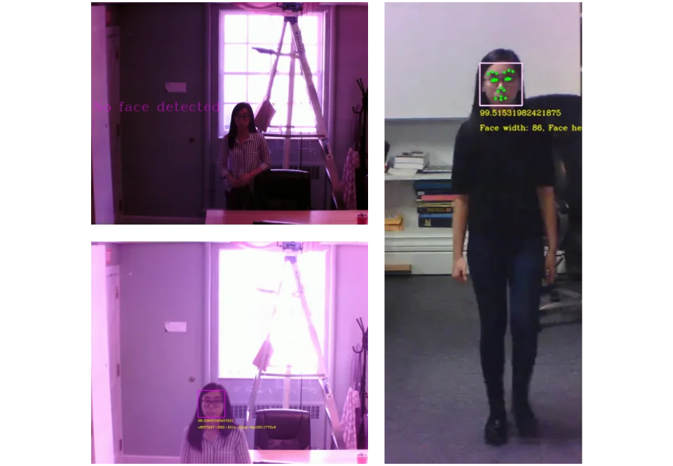
Figure 4: *Results from earlier face capture and recognition work performed by Perceive.*

This technical objective covers the development of an employee exclusion feature using facial recognition. Perceive has a history with this technology during a previous pilot conducted with a jewelry retailer in 2018 (Figure 4). This system was nearly built out but suffered from some debilitating limitations, namely: (1) a lack of high resolution images of store staff (2) inaccurate tracking that was intermittent and switch targets and (3) immature third party APIs from cloud providers which could not handle the variety of angles, lighting conditions, and facial contrast available today. Several notable improvements make the development of this system during a Phase IIB grant doable. Franchise companies, like the previous pilot, operate much more like small businesses, even if there are multiple locations, and collect less employee data during an onboarding session. Enterprises, specifically brands which operate their own showrooms, use cloud HR systems like PeopleSoft and WorkDay and have high resolution pictures for every staff member. These systems also include scheduling information that is typically siloed in small businesses, for example in spreadsheets sent via email. The APIs available provide profiles of employees with high resolution snapshots and face data that can be pulled and matched to schedules and facial information captured in store environments. *Crucially, Perceive will not attempt to register the facial information of normal customers - only employees which agree through an internal HR process.* As described under Phase II accomplishments above, the tracking technology (2) has advanced significantly in its ability to stay on the same target for 30 minutes or more and to distinguish people in crowded areas. This is important because registering faces takes advantage of accurate tracking. Finally, (3) third party APIs for facial recognition have advanced significantly, with the ever larger datasets and improved neural network architectures. For example, a major cloud provider touts the robustness of their face solution in low lighting conditions and with smaller resolutions. Much public scrutiny has also pressured companies to improve the demographic components of their systems. Perceive is poised to take advantage of this work, allowing for a robust face capture pipeline to be built.

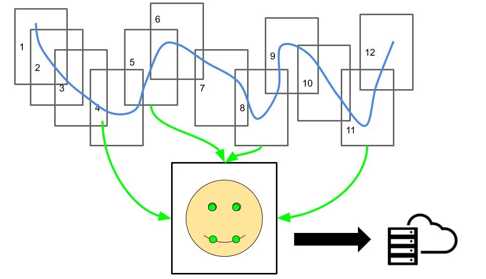
Figure 5: *Face capture during tracking pipeline. Each frame is numbered and the blue curved line represents the track going through each frame. Faces are selected and combined (green lines) and then fed to a central cloud server.*

In the past year, a surprising feature has been developed inside the tracking system: Gaze direction, or where a target person is looking. This data is now available and is an important component (among others) in deciding how engaged a customer is. This feature is useful for much more than analytics. Accurate gaze tracking enables the system to decide the optimal moment to capture a still of the face -- moments when the person is close to a camera and facing towards it. Figure 5 describes this setup. Once a track is processed, the best face stills from it are pulled and a decision algorithm uses rudimentary keypoints, even something classical like EigenFaces, to choose the best faces to feed to third party APIs. However, these faces will often be lower quality than is typically desirable for face recognition. Before a face is matched to an employee to filter them from the data, it must be scaled up using a research technique that is gaining momentum. Super resolution, or scaling low resolution data to a higher resolution, has seen increased attention due to the proliferation of IoT devices that capture images, sound, video, or other data. There is often a need to upgrade this data for viewing or for input into algorithms. For example, using a semi-supervised landmark detection system that leverages high and low resolution images to learn a scaling function. Perceive cameras are equipped with settings to take high resolution snapshots but normally capture video at lower resolutions to preserve network bandwidth. Periodically capturing a high resolution image provides a natural dataset for machine learning here.

Once a limited set of faces from a track is captured and superscaled they are fed to an API which has already registered the high resolution staff faces during onboarding and confirmed consent from staff members. A face comparison call is made, and the track is identified as either an employee, or not existing in the registration dataset, meaning the face is for a customer track. Each metric and video that is produced will include metadata so that a user of the dashboard can filter the metrics and visual data accordingly. The tasks for this technical objective are to program the facial registration system for the HR and third party APIs, develop a face capture method from existing track data, and implement a super scaling machine learning algorithm. Programmer [redacted] will spend 4 months on Tasks 1 and 2 and researcher Michaux will spend 3 months on Task 3. The key results of this technical objective are to identify employees vs customers compared to a hand annotated data set with a precision of 95%.

### Technical Objective 2: Produce 3D tracking results with existing camera infrastructure.

A key technical development during Perceive’s Phase I and Phase II grants was a technical solution for fast and easy installs of the camera and 3D recovery system. As described in the Phase I Accomplishments section, Perceive developed an innovative light fixture attachment system that enables business employees to install cameras with one (physical) click. During the Phase II grant a 3D recovery and mapping solution using a large but cheap box that could be carried around was also put in place. This enabled Perceive to install its system across rooms of greater than 8,000 sq ft in less than an hour. While this capability is necessary for setups with sparse or no camera coverage, it is less optimal for clients that have extensive security camera systems already. IT teams and operations directors at these organizations would prefer a software only solution that connects to existing camera devices. The distinctions between different types of cameras, and what they are good for does not matter to these buyers. And the argument is strong - why should it? Computer vision ought to be able to analyze feeds from many types of cameras, much in the way neural networks work on a wide variety of images. The key reason Perceive has not previously explored a solution like this is that our system relies on a 3D data, discussed extensively during the development of Phase II. With the research proposed in this technical objective, Perceive will extend a key breakthrough made earlier this year to tune the tracking system to produce the relevant 3D data from existing cameras from common security providers, thus solving a major architecture problem standing in the way of widespread adoption.

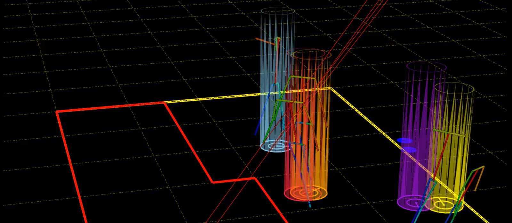
Figure 6: *Middle-out proportion distributions visualized during a tracking scenario.*

3D reconstruction, or measuring accurate distances in real units from flat video using computer vision, requires numerous constraints to solve for the real coordinate system. Currently Perceive employs a calibrated stereo camera system which is used to build depth maps that are registered with each other from overlapping camera views in a global 3D coordinate system. The dual camera views with known baseline are constrained enough to do reconstruction. To use existing cameras, however, there will only be monocular views, and the constraints must be found elsewhere. Perceive has developed a new technique to estimate a person’s size using known body proportion distributions. By applying these distributions to pose estimations it is possible to accurately calculate the height of a person and from there find the distance to other people, objects, and every pixel in the monocular view. Numerous machine learning techniques augment this process, and new developments are enabling 3D reconstructions for localization and mapping which rival the data produced by calibrated specialized sensors. Figure 6 demonstrates a visualization of this technique where each target is placed in a 3D space and the proportions are estimated and shown.

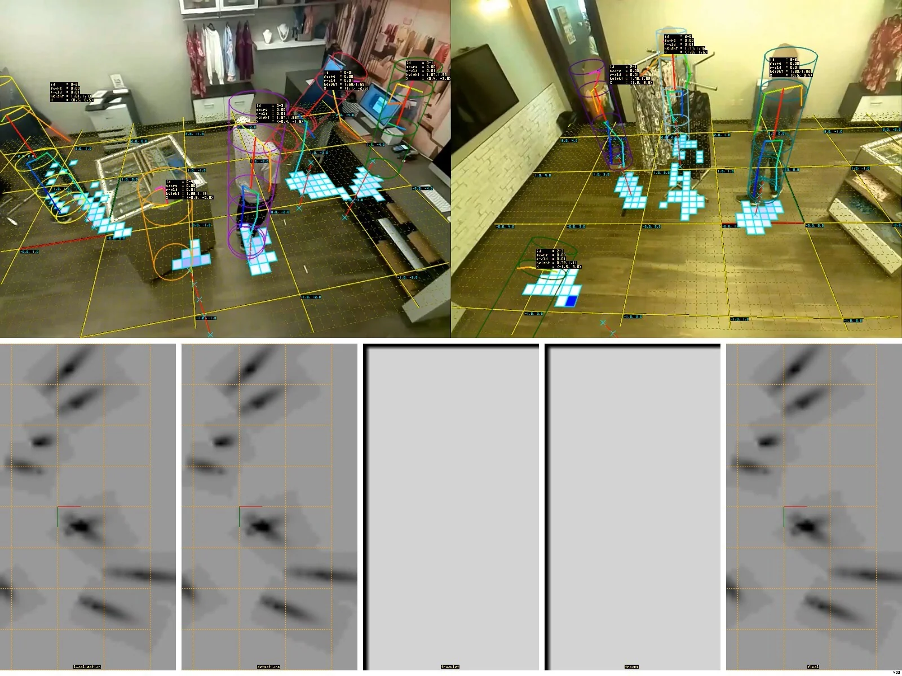
Figure 7: *3D reconstruction from pose estimation. On top the limbs of each person are shown along with their position on the floor plane (blue squares). On bottom the progressive estimation of the positions and gaze angles are shown.*

A full realization of this system includes pose estimations that accurately place a target person on a floor plane, in real world coordinates, along with gaze direction. Multi-camera stitching is still required, so that there is a unified 3D coordinate system across all cameras, however, each individual camera provides a monocular view. Figure 7 shows such a system. Some 3D point cloud data was used in generating this image, as part of a comparative exploration between the two using stereo and monocular data. A business process critical to utilizing existing monocular installations, is to gather, or otherwise estimate, calibration information for customer camera systems. This includes both intrinsic calibration data (the camera matrix), and estimating the pose -- position and direction -- of each monocular camera in 3D space. Most manufacturers provide some intrinsic calibration data but in some cases Perceive may need to acquire and calibrate specific camera models. Further complicating this task is the prevalence of fish-eye lenses throughout the security marketplace. Fisheye lenses produce profound distortions, and often require calibration in carefully controlled environments. Perceive has developed a custom calibration framework for previous monocular work, which combines optimization techniques and a custom calibration rig to produce finely detailed parameter sets for undistortion.

No matter how intrinsic calibration is generated, it will be entered into the 3D recovery system and the architecture must be robust to multiple cameras. A heterogeneous multi-camera system like this does not exist in the market and will dramatically enhance Perceive’s differentiation and technical moat. The tasks of this objective are to precisely test the fidelity of tracking in monocular views using existing hardware and to develop a camera agnostic calibration input architecture while maintaining tracking performance. A data scientist will spend 2 months testing and quantifying the accuracy of the system in monocular views and 4 months building a calibration architecture which is efficient for Perceive to use to onboard many types of businesses with common sets of popular cameras. The key results for this objective are to deliver performance within 10% of the precision and recall of the current tracking system across the top three most popular business camera systems.

### Technical Objective 3: Real-time output of tracking results for immediate feedback.

Figure 8: *Performance measurements of various stages of the tracking pipeline.*

As of today, Perceive’s software provides businesses with new, and often startling, glimpses of customer experience in the process of buying, trying, and interacting with products. However the system lacks a key feature which unlocks a clear return on investment story for customers. That feature is the ability to understand customer experience in real-time, and take action on what is happening through some automated process. For example, a retailer may want to display a targeted ad based on what a shopper is currently looking at in an aisle or a showroom may want to alert an associate to assist a customer in a far corner of the building. In addition, real-time unlocks a new market in security. This is important because Perceive’s vision is to create a platform for capturing many types of human behavior. Security is also one of the largest markets utilizing video analytics today and any go to market plan should include it. Today, the Perceive system is 10-30 minutes delayed from when video is captured to when results are available. Some of this delay is caused by the video capture architecture and some by the actual analysis and tracking of the videos (Figure 8). First, the research challenges of tracking and pose estimation will be addressed, followed by the engineering challenges of video streaming and capture.

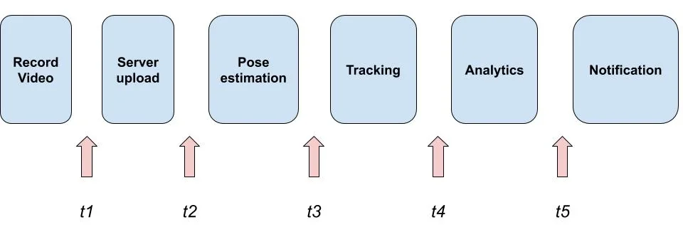
Figure 9: *Stages of computer vision pipeline (t1-t5) which would need to be optimized to generate real-time results.*

To evolve from a batched tracking system to a frame by frame execution there are several current architecture decisions to consider. Figure 9 shows the principle high level steps in the video analysis. The proposed research of this technical objective focuses on time t2 and t3 where the actual tracking is done. There is room for optimization in the other steps as well although these are engineering challenges with known solutions (e.g. video streaming). Time t2 is spent in pose estimation and 3D point cloud building. For pose estimation, the network itself and the filtering steps to produce a clean pose is tunable. In addition, there has been extensive work on real-time pose estimation in recent years. Another optimization opportunity is to carefully split resources between GPUs and CPUs, in order to take advantage of the still-increasing compute power available on GPUs. The tracker itself is almost, but not quite, fast enough for real time performance. The bottlenecks that are ideally suited to GPU computation. Finally, the tracker currently assumes a perfect video sequence from all cameras. With a streaming architecture there are likely to be dropped frames and possibly other missing data. Building and traversing an incomplete graph is a key research challenge to accommodate live data. Aside from performance, there are several improvements scheduled for the tracker itself. The tracker currently has 33 tunable parameters, suggesting that it can be rewritten as a machine learnable decision tree, which not only tunes these parameters, but also intelligently weighs correlations between different lines of available evidence, in a way that is infeasible for handcrafted solutions. In addition, a reinforcement learning technique that combines neural networks and the Monte Carlo Tree Search (MCTS) algorithm is being investigated. This approach allows the tracker to specify what types of outputs are needed -- long smooth tracks -- and have a machine learning algorithm discover the correct parameters for building the tracks. Both the decision tree method, and the MCTS method increase the ability of Perceive engineers to incorporate streaming architectures and make appropriate tradeoffs. In conclusion, the research tasks of building an incomplete tracking graph and incorporating the very latest pose networks across appropriate cloud servers is the key challenge to address in this technical objective.

Regarding times t1, t4, and t4 in Figure 9, several engineering steps must be taken. For example, cloud servers have warm up times where they are not fully ready to run programs. Therefore Perceive must keep a batch of servers ready to start accepting and processing data. The cameras themselves must be able to support efficient streaming protocols and network traffic must be routed efficiently so that a frame arrives for image analysis as soon as possible after it is captured. As discussed above, steps need to be taken to guard against dropped frames and other known defects with streaming video. This includes monitoring and alerting which can pinpoint traffic chokepoints. Fortunately, cloud providers already have platforms for video ingestion and streaming and so much of this engineering becomes more configuration than the build out of a full video streaming backend. Data availability to the customer is another engineering task. Notifications of events need to be deduplicated, dashboards need to update while the user is on the webpage without a refresh, and backup data needs to be stored to disk even while real-time processing continues. The Perceive team has years of experience with these issues having previously architected a system which could process a billion images a day, on the order of the number of images uploaded to Facebook every day. The tasks for this technical objective are to deploy and tune a real-time pose estimation network, construct an algorithm for an incomplete (sparse) tracking graph, and software engineering for reliability and real-time updates throughout the Perceive infrastructure. A data scientist will spend 6 months on Tasks 6 and 7 and systems architect Berry will spend 3 months on Task 8. The key results of this objective are to deliver tracking results of the same quality as today to the frontend with 30 seconds of the event happening in showroom environment.
